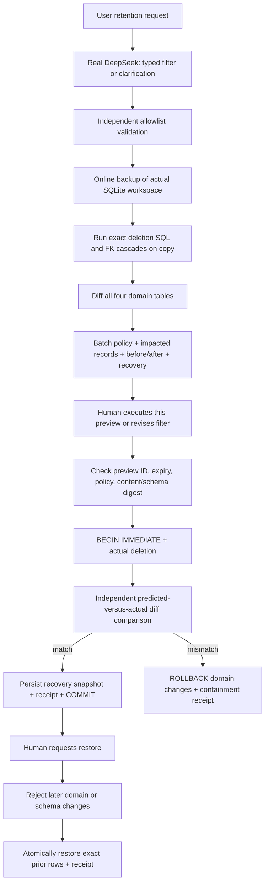

# Intent → simulate → present → execute / rollback

The browser sends bounded commands through a public Worker. A HttpOnly, SameSite=Strict cookie identifies a workspace; the host checks its server-stored CSRF value and any supplied Origin. The session ID, not a browser-provided directory or owner field, selects the SQLite workspace. The server accepts no raw SQL or approval flag.

D1 stores sessions, counters and transient jobs. The authenticated PC worker atomically claims a pending job once, clears its queued input and calls a bounded operation. Completion has a lease; results are removed after delivery or timeout. Heartbeats report actual connection availability. Service credentials and provider credentials remain separate. The provider key is local only.

SQLite is authoritative for the actual support data. Simulation uses Node's online backup to produce a separate database, verifies its content/schema digest, then commits the same `mutate()` function on that copy. It compares complete ordered rows, including FK cascades. The original is checked again after simulation to refuse concurrent drift. Copies are removed in a finally block; this is file deletion, not forensic secure erasure.

Each preview binds its filter, predicted full row diff, policy version, source version, source content/schema digest and three-minute expiry. The batch policy allows at most five ticket roots and 24 dependent rows; a blocked or empty preview cannot execute. Newer data does not get silently folded into an old approval.

Actual execution starts an immediate transaction and rechecks the preview's bindings. It runs the exact same deletion, then compares every deleted, inserted or updated domain row with the predicted diff. A mismatch rolls back the transaction before any domain change commits. A containment receipt and preview consumption are then recorded separately. The controlled fault changes a customer preference only in actual execution, so the normal simulation deliberately under-predicts it.

A committed change stores its exact pre-execution domain snapshot and post-execution domain/schema digest. Restore first checks that digest in an immediate transaction; later changes cause refusal. It restores parents/children in foreign-key-safe order, verifies the restored snapshot, advances the version and records a receipt. Recovery never rewinds the audit history.

There is no arbitrary schema support, production connection, messaging adapter or external deletion. Local SQLite transactions cannot retract an email or financial transaction. The current guarantee is bounded by these four known domain tables and the real database API used by the demo. A model-generated explanation is never treated as a simulation.
