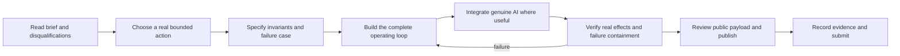

# Rehearse methodology map

Mission: [Simulate Before You Act](https://build.doo.ooo/challenges/simulate-before-act). Official brief reviewed October 16, 2026.

Apply this sequence to every subsequent mission; completion means verified deliverables, not just a rendered page.

## Product and judging contract

- Real action: SQL deletion of persisted support tickets and cascading notes/attachments in a visitor's disposable SQLite workspace. No production system, real customer data or external communication is connected.
- Useful AI: DeepSeek translates a natural-language retention request to a small typed filter. It cannot execute SQL, grant approval or invent predicted counts. Ambiguous/unsupported requests must ask for clarification.
- Simulation: online-backup the actual database, run the exact mutation on the copy, diff every domain table, then remove the disposable copy. Show roots, cascades, preserved records, affected customers and rollback policy.
- Authority: the human executes a specific fresh preview in one step. The server binds that preview to the database content/schema digest, filter, policy version and expiry.
- Failure test: inject a faulty adapter that changes customer preferences only during actual execution. Independently compare observed database changes with the preview inside the same transaction. On disagreement, roll back all domain changes and record the failure.
- Rollback: restore the pre-execution domain snapshot atomically only if the current domain digest still equals that execution's result. Reject stale restore attempts and record actual restored row counts.
- Evidence: unit/integration checks against actual SQLite, genuine provider request receipts, browser workflow, public deployment, clean source run, <=300-word thesis and architecture/failure documents. A recording is optional in the submission checklist; never fabricate a continuous capture.

## Delivery gates

1. Select mission and map requirements. Complete.
2. Implement real database, simulation, execution and rollback. In progress.
3. Integrate live AI and the public PC-backed service. Pending.
4. Verify normal and adversarial paths, including the browser. Pending.
5. Publish sanitized GitHub source and public Site. Pending.
6. Submit the actual entry and retain its confirmation locally. Authorized by the user's request; pending verification.
